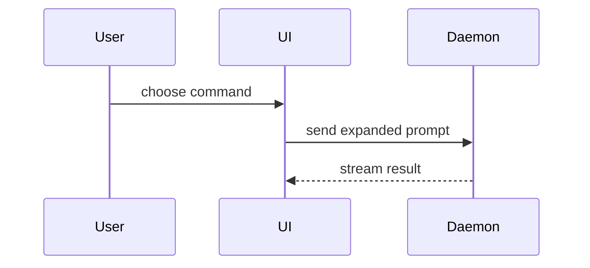

PR 본문은 이 템플릿으로 쓴다:

```markdown
## Summary

<다이어그램, diff 스케치, 또는 트리>

## Evidence

- **Before:** <스크린샷/출력/실패한 테스트 실행>
  **After:** <스크린샷/출력/통과한 테스트 실행>

## Merge Danger

**Door:** <one-way 또는 two-way>

<선택: 설명>

**Blast Radius:** <한 단어 설명>

<선택: 머지로 생길 수 있는 파급 효과>
```

## 절

서두는 모두 건너뛰고 글은 짧게 쓴다. `GLOSSARY.md`에 있는 사용자의 도메인 언어를 쓴다.

### 요약 (Summary)

핵심을 분명히 보여 주는 가장 작은 뷰를 고른다.

- 로직이나 알고리즘은 의사코드로 보여 준다:

```text
on(save)
  if content is unchanged
    return cached result
  write new content
  return fresh result
```

- 실행 시점의 제어 흐름은 호출 트리로 보여 준다:

```text
submitForm
  createSession
    persistPrompt
    launchAgent
  navigateToSession
```

- UI 구조는 컴포넌트 트리로 보여 주되, 중요한 상태와 모듈 경계를 포함한다:

```text
<SessionPage> (apps/example/src/routes/session.tsx)
  useSessionEvents()
  <SessionToolbar>
    <RunSkillButton> (packages/ui)
```

- 파일별 책임이나 넓은 리팩터링은 얕은 파일 트리로 보여 준다:

```text
src/
├── commands/       # 사용자 동작을 파싱한다
├── sessions/       # 세션 상태를 소유한다
└── transport/      # API 요청을 보낸다
```

- 컴포넌트 간 상호작용, 제어 흐름, 데이터 흐름은 Mermaid로 보여 준다:



- 무엇이 바뀌는지가 요점이고 주변 모양이 이미 있을 때는 `diff`를 쓴다. diff의 모양을 주제에 맞춘다.

컴포넌트가 바뀔 때:

```diff
 <SessionPage>
   useSessionEvents()
   <SessionToolbar>
+    <RunSkillButton />
   <SessionTimeline>
+    <SkillResultCard />
```

파일 배치가 바뀔 때:

```diff
 src/
 ├── commands/
+│   └── show-me.ts       # 슬래시 명령을 펼친다
 ├── sessions/
-└── transport.ts
+└── transport/
+    ├── client.ts
+    └── stream.ts
```

호출 트리나 호출 스택이 바뀔 때:

```diff
 submitForm
   createSession
     persistPrompt
+    expandSkillMention
     launchAgent
-  navigateToSession
+  navigateToSession
+    subscribeToEvents
```

상태나 제어 흐름이 바뀔 때:

```diff
 on(save)
-  write content
+  if content is unchanged
+    return cached result
+  write new content
+  invalidate cache
```

- 대부분이 새 코드이거나, 생략한 맥락 때문에 소유 관계나 순서가 가려지거나, 사용자가 복사해 쓸 목표 모양이 필요할 때는 블록 전체를 보여 준다:

```ts
function expandSkill(command: string): string {
  const skillName = command.slice(1);
  return `use the ${skillName} skill`;
}
```

#### 지침

각 시각 자료는 그것이 뒷받침하는 짧은 글 바로 옆에 둔다. 사용자의 현재 질문에 답하거나 현재 논의 지점을 풀 선택지를 보이는 데 필요한 호출, 파일, props, 상태, 경계만 남긴다.

이 중 하나를 쓸 수도, 여러 개를 쓸 수도 있다. 모두 쓰게 될 가능성은 낮다. 판단해서 쓰고 사용자를 압도하지 않는다.

### 근거 (Evidence)

변경이 동작한다는 구체적인 근거. 전과 후를 보여 준다.

스크린샷은 S등급이다. 환경이 갖춰져 있고 변경이 시각적일 때 해당한다.

실행 기반 근거는 A등급이다. 테스트 결과, 콘솔 출력이 해당한다. 이전에는 실패하고 지금은 통과하는 바로 그 테스트를 의사코드로 보여 준다.

### 머지 위험 (Merge Danger)

one-way door인지 two-way door인지 적는다. two-way door는 되돌아 나올 수 있지만 one-way door는 그럴 수 없다. 롤백 비용이 낮은 PR은 위험이 더 낮다. 파괴적인 동작이나 되돌리기 어려운 결정이 들어간 변경은 one-way door다.

blast radius는 이 PR이 들여오는 변경이 미칠 수 있는 영향 또는 범위다. 가능한 경우를 모두 고려한다. 예: 레이아웃 이동, 소비자 쪽 깨짐, 모바일 반응성 등.
